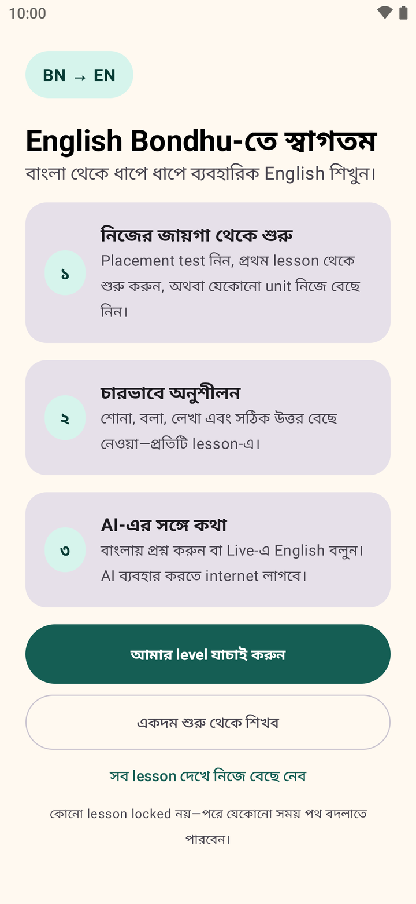
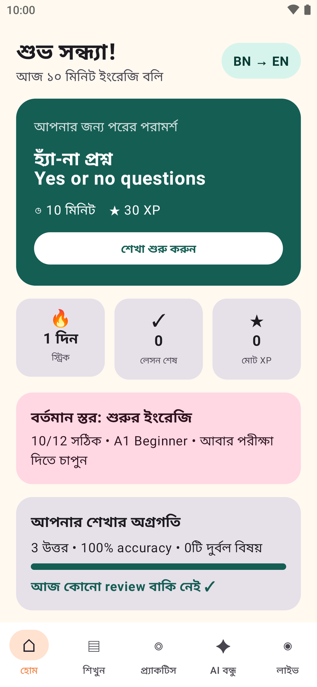
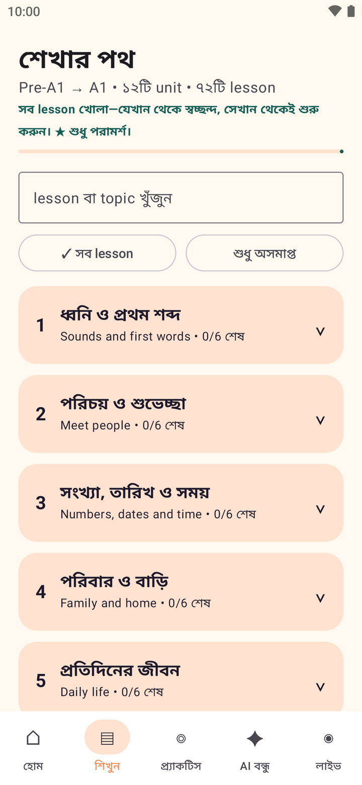
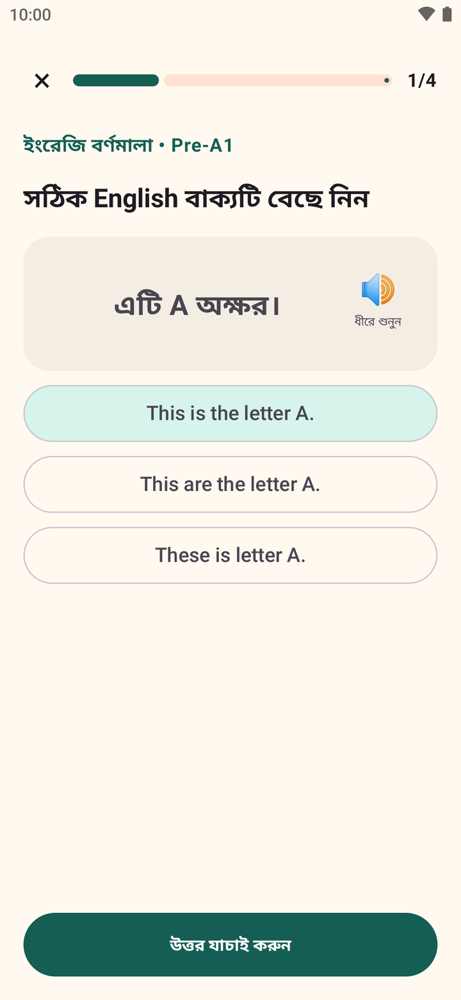
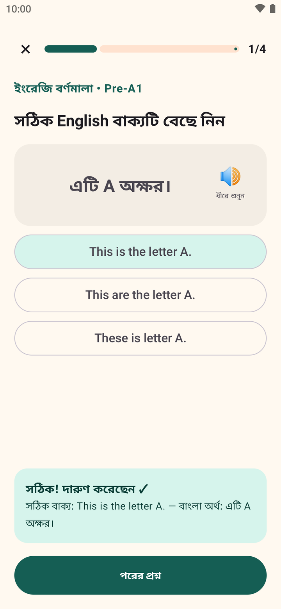
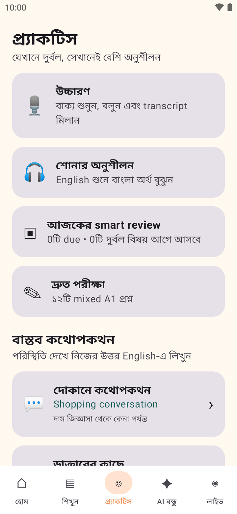
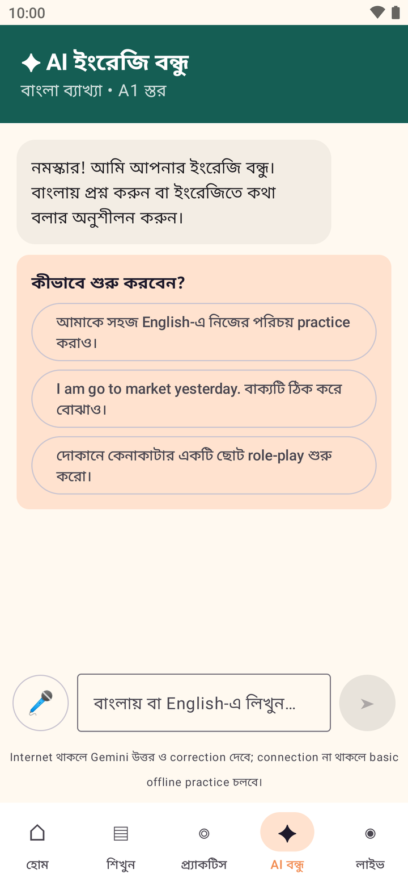
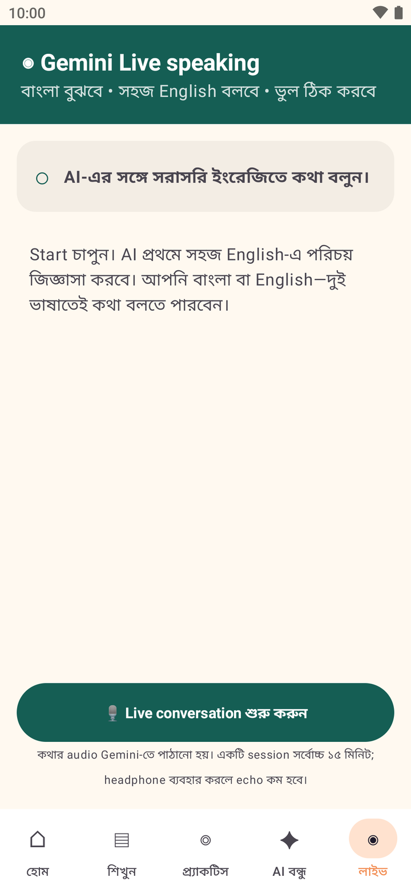

# English Bondhu

A Bengali-first English-learning app for Android, built with Kotlin and Jetpack Compose. Learners work through a 72-lesson Pre-A1 → A1 path with instructions in Bengali, practise listening, speaking, reading and writing, and can talk to a Gemini-powered tutor by text or by live voice.

<p align="center">
  
  
  
  
</p>
<p align="center">
  
  
  
  
</p>

<p align="center">
  
</p>

Screenshots and the recording come from an Android 11 emulator. The emulator has no Gemini key, text-to-speech voice or speech-recognition app installed, so these images show the lesson flow and the AI screens before a conversation starts. They do not show a live Gemini reply.

## What it does

- **Curriculum:** 72 lessons in 12 practical units (greetings, numbers, family, shopping, travel, health, past tense and more). Every lesson has four exercise types: multiple choice, listening, speaking and translation.
- **Answer checking:** `AnswerChecker` normalises case, punctuation and common contractions (`I'm` = `I am`) and accepts one or two typos. Missing or changed words are still marked wrong.
- **Spaced repetition:** each answer updates an SM-2 schedule. Practice → Smart Review shows due and weak items first.
- **Placement test:** 12 questions pick a starting level and a recommended lesson. All lessons stay unlocked.
- **Dialogue practice:** shopping, doctor, interview and phone-call scenarios.
- **Speech:** Android text-to-speech reads prompts at a slower beginner rate. Speaking exercises use the device's speech-to-text. On devices without a speech-recognition app, the app shows a message instead of crashing.
- **AI Bondhu (text):** the tutor corrects the learner's English, explains the correction in simple Bengali and asks a follow-up question. It uses Gemini structured JSON output. If Gemini cannot be reached, a small keyword-based offline tutor answers instead.
- **Live (voice):** a Gemini Live WebSocket session streams 16 kHz microphone audio and plays the 24 kHz spoken reply. The screen shows a transcript of both sides. While the model is speaking, the app stops sending microphone audio so the tutor does not hear its own voice.
- **Progress:** completed lessons, XP, daily streak, accuracy and placement result are saved on the device (SharedPreferences).

## How it is built

```text
ui/EnglishBondhuApp.kt       Compose screens: Welcome, Home, Learn, Practice, AI Bondhu, Live, lesson session
domain/LearningEngine.kt     AnswerChecker, SM-2 SpacedRepetition, PlacementEngine, StreakCalculator (pure Kotlin)
data/                        Curriculum content, placement/dialogue sets, ProgressStore (SharedPreferences)
ai/AiTutor.kt                Gemini REST tutor -> optional local gateway -> offline fallback
live/GeminiLiveSession.kt    Gemini Live audio-to-audio session (OkHttp WebSocket, AudioRecord/AudioTrack)
backend/server.py            Optional local Python gateway that keeps the Gemini key off the phone
```

The tutor tries three options in order:

1. If the APK was built with `GEMINI_API_KEY`, it calls the Gemini API directly.
2. Otherwise it calls the local gateway at `AI_BASE_URL` (default `http://10.0.2.2:8787`, which is the host machine as seen from the emulator).
3. If that also fails, the offline tutor answers.

The Live tab needs a key built into the APK.

## Setup

Requirements: JDK 17 and the Android SDK with platform 36 (Android Studio installs both). The app runs on Android 8.0 (API 26) and newer.

```powershell
.\gradlew.bat testDebugUnitTest assembleDebug
```

The APK is written to `app\build\outputs\apk\debug\app-debug.apk`. Open the folder in Android Studio and run the `app` configuration to install it on an emulator or phone.

### Gemini key (optional)

Lessons, practice and the offline tutor work without a key. To use Gemini, add your own key to the git-ignored `local.properties` file in the project root:

```properties
GEMINI_API_KEY=your-key-here
# Optional: point the app at the local gateway instead (for example a LAN IP for a real phone)
# AI_BASE_URL=http://10.0.2.2:8787
```

You can also pass the key as `-PGEMINI_API_KEY=...` or set it as an environment variable. Never commit the key. A key built into an APK can be extracted from it, so a key-carrying build is for personal testing only. A public release should use the gateway (or short-lived tokens) instead.

### Local AI gateway (optional)

The gateway keeps the key on your computer instead of in the APK:

```powershell
.\start-ai-backend.ps1        # asks for the key without echoing it
Invoke-RestMethod http://127.0.0.1:8787/health
```

It has `/v1/tutor` and `/v1/speech-feedback` endpoints, a per-IP rate limit and a request-size cap. Run its tests with `cd backend; python -m unittest`.

## Tests

- `LearningEngineTest`: answer checking, SM-2 intervals, placement levels and accuracy.
- `StreakCalculatorTest`: the streak grows on consecutive days and resets after a missed day.
- `TutorReplyFormatterTest`: parses Gemini responses (including JSON split across parts) and checks the offline tutor.
- `CourseContentTest`: checks that the curriculum has 72 lessons, all four exercise types in every lesson, unique IDs, and correct answers present among the choices.
- `backend/test_server.py`: gateway prompt validation and reply formatting.

## Status and limitations

- This is a working prototype. The curriculum is internally reviewed but has not yet been checked by a qualified Bengali/English teacher. See [CURRICULUM_REVIEW.md](CURRICULUM_REVIEW.md).
- The speaking exercises compare the speech-to-text transcript with the target sentence. They do not grade pronunciation. Only the Live tab sends real audio to the model.
- Progress is stored only on the device. There are no accounts and no sync.
- Device testing so far covers one Android 13 phone plus the emulator ([UX_AUDIT.md](UX_AUDIT.md), [TESTING_GUIDE.md](TESTING_GUIDE.md)).

Planning notes: [PRODUCT_PLAN.md](PRODUCT_PLAN.md), [OPEN_SOURCE_EVALUATION.md](OPEN_SOURCE_EVALUATION.md).
